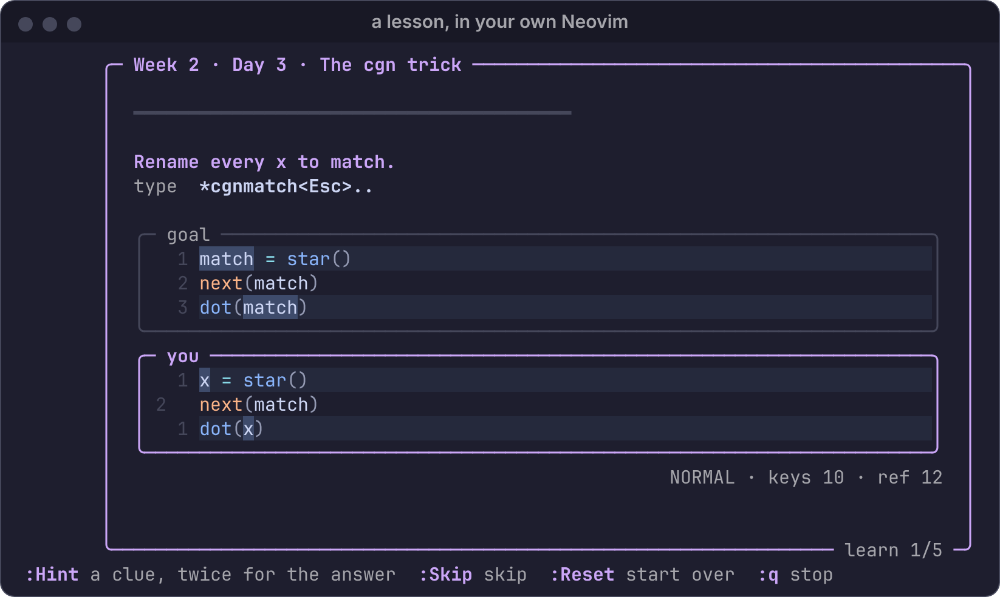
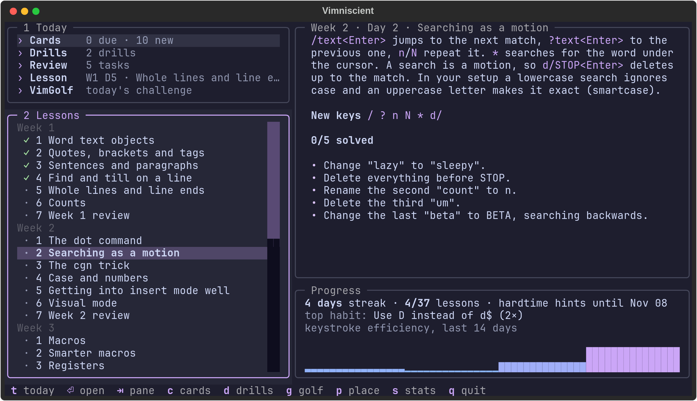

# Vimniscient

<p align="center">

</p>

**Get fluent in Vim with about fifteen minutes of practice a day, in your own Neovim.**

You've done `vimtutor`, you can get around, and you still reach for `jjjj`
and Backspace. Vimniscient is the next step. It gives you real editing tasks
that run in the Neovim you use every day, with your config, plugins and
colours. A reference solution shows you a shorter way, and spaced repetition
brings each skill back until it sticks.

**Website:** [vimniscient.com](https://vimniscient.com)

<p align="center"></p>

## How a lesson works

Each task shows the goal at the top and your text below, with the
differences highlighted. Edit until they match, and the next task loads by
itself. There's nothing to submit, and any way of getting there counts.

Every lesson has two rounds:

1. **Learn**: each task with the keys to type shown next to it, so you use
   exactly what you'll need to remember.
2. **Recall**: the same skills come back on different text, in a different
   order, with the keys hidden. Only this round counts towards your progress.

Every task has more than one text, and each review gives you the next one.
That way you remember the skill, not the sentence.

The texts are mnemonic: most of them say what the key you're practising
stands for (`ciw` is *change inner word*, `:t` is ed's *transfer*), and the
rest are facts about how memory and skill learning work, with sources in
[`lessons/sources.md`](src/vimniscient/lessons/sources.md). After you answer a
card, or at the end of a lesson for the tasks you missed, Vimniscient shows
what each part of the keys stands for. It never shows that before you answer,
because that would give the answer away.

Can't recall one? `:Skip` it. You'll see the answer, type it once with the
keys shown, and get the task again at the end of the session, on its other text.

Your keystrokes are counted the same way [VimGolf](https://www.vimgolf.com)
counts them, and afterwards you see your keys next to the reference
solution. If `ciwbuf<Esc>..` took you 14 keys and the reference does it in
10, you'll see how.

Stuck? Type `:Hint` (twice for the answer). `:Skip` and `:Reset` do what
they say, and `:q` stops.

## Quick start

You need Linux (macOS should work but is untested), [Neovim](https://neovim.io) 0.10 or newer,
Python 3.11+ and [uv](https://docs.astral.sh/uv/).

```bash
uv tool install git+https://github.com/dialectmaterial/Vimniscient
vimniscient
```

1. Press **`p`** for the placement test. It gives you two tasks from every
   lesson and skips the ones you already know. `:Skip` whatever you don't.
2. From then on, press **`t`** once a day. The Today pane shows what's left
   and about how many minutes it takes.
3. On [Omarchy](https://omarchy.org), `vimniscient reminders install` reminds
   you when you start your day (see [reminders](#optional-reminders-omarchy)).

Your progress is kept in `~/.local/share/vimniscient/`. Vimniscient doesn't
change your Neovim config.

## What you'll learn

37 lessons and 194 tasks (each with two texts) over six weeks, one lesson a day:

| Week | Topics |
|---|---|
| 1 | Text objects (`ciw`, `da"`, `dap`), `f`/`t`, line commands, counts |
| 2 | The dot command, search as a motion, `cgn`, case and numbers, getting into insert mode well, visual mode |
| 3 | Macros, registers, marks, visual block, `:s` and `:g` |
| 4 | Ranges (`:m`, `:t`), `:sort` and shell filters, patterns, `:norm`, more motions, indenting |
| 5 | [LazyVim](https://www.lazyvim.org)'s text objects (arguments, any quote or bracket, functions, classes, sub-words) and comments. Only shown if you use LazyVim |
| 6 | Real edits on code, notes and data, each mixing several tools |

Each week ends with a review day. Every reference solution is tested: the
plain-Vim ones in `nvim --clean`, and all of them typed at full speed into a
LazyVim setup.

## A day with Vimniscient

`t` runs the daily routine:

1. **Cards**: short prompts ("Change everything inside the quotes"), where you
   type the keys (`ci"`). The ones that are due come first, then up to 10 new ones.
2. **Review**: tasks from earlier days that are due again.
3. **Today's lesson**.
4. **[VimGolf](https://www.vimgolf.com)**: one real challenge a day, starting
   with the most played ones. You play it in your Neovim, and your score is
   compared with the site's leaderboard.

Press **`e`** for **Endless** whenever you have time left: tasks from every
lesson, one after another, for as long as you like. Each one you solve climbs a
level. New lessons join the mix as you climb, and the key budget shrinks from
about twice the reference to exactly the reference by level 200. Go over the
budget, `:Skip`, or ask for the answer, and it's a miss. You'll see the answer,
type it with the keys shown, and a couple of tasks later the same skill comes
back on another text, from memory. Each run starts a little below where the
last one ended.

Cards and tasks share one spaced-repetition schedule, like Anki. Whatever
went well comes back later, and whatever you forgot comes back tomorrow.

<p align="center"></p>

The home screen shows everything at once: today's routine, the lessons
(✓ solved, ◐ started, ○ skipped by the placement test), the selected
lesson, and your progress with a keystroke-efficiency graph.

| Key | Action |
|---|---|
| `t` | Run today's routine |
| `Enter` | Start the selected step or lesson |
| `Tab`, `j`/`k` | Move between panes and through lists |
| `e` | Endless mode |
| `c` / `g` / `p` | Cards / VimGolf / placement test |
| `s` | Stats |
| `q` | Quit |

## It adapts to your setup

| You have | You get |
|---|---|
| Neovim | Weeks 1–4 and 6, Vim and shell cards, VimGolf |
| [LazyVim](https://www.lazyvim.org) | Week 5, plus LazyVim cards whose names and keys are read from your own config |
| [hardtime.nvim](https://github.com/m4xshen/hardtime.nvim) | Your bad habits become cards ("You typed `2dd`. What's shorter?"). When you lean on `hjkl` a lot, review brings back the motion lessons |
| [Omarchy](https://omarchy.org) / Hyprland | Cards for every desktop and tmux keybinding (read live), and live drills (`d`): "send this window to workspace 9 and fetch it back", checked through Hyprland's events |
| foot, Zathura | Cards for their keys |

### Optional: practice while you work

[`extras/nvim/vimniscient.lua`](extras/nvim/vimniscient.lua) is a
[lazy.nvim](https://github.com/folke/lazy.nvim) plugin spec. Copy it to
`~/.config/nvim/lua/plugins/` if you want:

- [hardtime.nvim](https://github.com/m4xshen/hardtime.nvim): hints when you
  do things the slow way, for your first two weeks. After that it blocks
  them, along with the arrow keys.
- [precognition.nvim](https://github.com/tris203/precognition.nvim): shows
  where `w`, `b`, `e`, `$` … would take you. It starts hidden; toggle it with
  `<leader>uV`.

### Optional: reminders (Omarchy)

```sh
vimniscient reminders install
```

The first reminder comes when you start using the computer: at login, or at the first unlock
after 07:00. It lists what's left of today's routine and about how long each
part takes ("about 13 min left today"). Click it to open Vimniscient. While something is
left, another reminder comes every three hours until 21:30, and each one works out again
what's left. Once you've done everything for the day, no more reminders come.

The follow-ups are ordinary Omarchy reminders, so they show in the bar and in
`omarchy reminder show`, and `omarchy reminder clear` cancels them.
`vimniscient reminders` shows what's left and when the next one comes, and
`vimniscient reminders uninstall` turns them off. Today counts as done once
the cards, drills and review are cleared and you've done one lesson and the
VimGolf challenge.

## Questions

**Why not just use vimtutor, Vim Adventures or VimGolf?** Use them! vimtutor
teaches the basics, and this picks up after it. Vimniscient runs in your real
editor, schedules what you need to repeat, and turns VimGolf into a daily
habit.

**Does it work with my plugins?** Yes, that's the point. For a lesson it only
turns off what would type for you (autopairs, completion, format-on-save),
plus [which-key](https://github.com/folke/which-key.nvim), which replays your
keys and would make them count twice.

**My answer to a card was right but got marked wrong.** Common notations are
accepted (`<C-a>`, `ctrl-a`, `^a`; `<leader>ff`, `space ff`). If yours still
fails, press `o` ("I was right").

## Writing lessons

Lessons are YAML files in [`src/vimniscient/lessons/`](src/vimniscient/lessons).
`▮` marks where the cursor starts:

```yaml
week: 1
day: 1
title: Word text objects
intro: |
  Shown before the lesson starts.
keys: [ciw, daw]
tasks:
  - goal: 'Change "slow" to "quick".'
    start: |-
      The sl▮ow brown fox.
    target: |-
      The quick brown fox.
    solution: ciwquick<Esc>   # the reference; its length is the "ref" count
    hint: ciw changes the inner word under the cursor.
    ft: python                # optional filetype
    variants:                 # the same skill on other texts, for Recall and reviews
      - goal: 'Change "big" to "small".'
        start: |-
          A b▮ig corpus.
        target: |-
          A small corpus.
        solution: ciwsmall<Esc>   # whatever a variant leaves out, it takes from the task
```

More details:
- `␣` stands for a space that must survive editors stripping trailing whitespace.
- `review: true` marks a review day (the placement test skips it).
- `lazyvim: true` marks lessons that need LazyVim.
- Indented text needs an indentation indicator (`|2-`), or YAML strips the leading spaces.

The texts are mnemonic. Where you can, write a sentence that says what the
key stands for, so that the edit leaves it true: `ciw is change inner word:
it swaps the wh▮ile word` (fix it with `ciw`). What each key officially means,
and the hook to use where it means nothing, is in
[`mnemonics.yaml`](src/vimniscient/mnemonics.yaml). The app reads the same
file to say what a key stands for after you answer. Other sentences are about
how memory and skill learning work; every such fact needs a source in
[`lessons/sources.md`](src/vimniscient/lessons/sources.md). Code tasks stay
code, with the meaning in names and strings.

Before sending a lesson, check that every solution (variants included) really produces its target:

```bash
uv run python tests/check_lessons.py            # plain-Vim lessons, in nvim --clean
uv run python tests/check_lessons.py --lazyvim  # LazyVim lessons, in your own config
uv run python tests/check_answers.py            # card answers written different ways
uv run python tests/live_lessons.py --all       # types every solution into the real runner (needs tmux)
uv run python tests/live_retry.py               # a skipped task comes back (Learn, then Recall)
uv run python tests/live_review.py              # a review session, as review, placement and VimGolf run
uv run python tests/live_endless.py             # endless mode: a miss, its Learn copy and its Recall
```

## How it works

`vimniscient` is a [Textual](https://textual.textualize.io) app. A lesson
starts `nvim` on a scratch file with
[`runner.lua`](src/vimniscient/nvim/runner.lua). It shows the goal in a
diffed split, checks your text after every change, and counts the `typed`
part of `vim.on_key`: what you pressed, before any mapping applied.

- [`today.py`](src/vimniscient/today.py) works out today's routine and how
  long what's left takes; the home screen and the reminders both use it.
- [`reminders.py`](src/vimniscient/reminders.py) sends the reminders as
  Omarchy reminders (systemd timers named `omarchy-reminder-*`), each of
  which checks again when it fires.
- [`mnemonics.py`](src/vimniscient/mnemonics.py) splits keys like `ciw` or
  `:%s//x/g` into parts and looks each one up in `mnemonics.yaml`.

### The website

[vimniscient.com](https://vimniscient.com) is the static site in
[`website/public/`](website/public), served by Cloudflare Workers. To try it
locally and to publish it (needs Node 22.18+ and the
[`cf`](https://developers.cloudflare.com/cf/) CLI, signed in):

```bash
cd website && npm install
npx cf dev       # serves it locally
npx cf deploy    # publish
```

## License

[AGPL-3.0](LICENSE)
